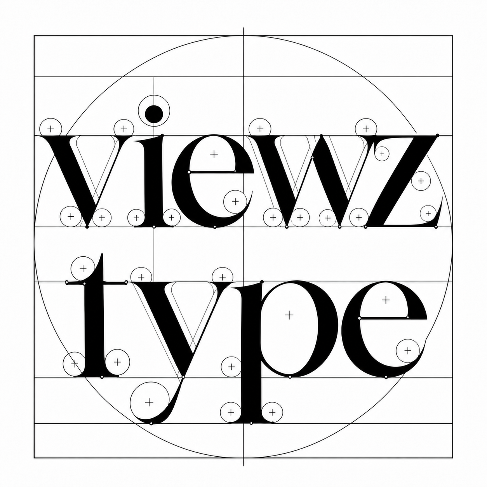

<p align="center"></p>

# VIEWZ Type

Application web, dans le navigateur, pour retrouver une typographie à partir d'une image, reproduire un alphabet à partir de quelques lettres, et créer une police installable (.otf).

Démonstration : https://loewinskiivan-code.github.io/viewz-type/

*English: a browser app that finds the closest Google Fonts typeface from an image of letters, rebuilds a full alphabet from a few letters of your own, and exports an installable .otf font. No install, no server. AI features are optional and use your own API key.*

## Ce que fait l'application

- **Rechercher** : dépose une image de lettres, l'app mesure les formes et propose les polices les plus proches parmi 2 032 polices (1 360 familles) du catalogue Google Fonts.
- **Reproduire** : à partir de quelques lettres à toi (dessin, calligraphie, broderie, image générée), l'app détoure tes lettres, choisit une police libre « donneuse » proche, l'ajuste à tes mesures et construit un alphabet complet. Une jauge indique quelles lettres fournir pour gagner en fidélité.
- **Créer** : des pistes guidées (linéales, empattements, médiévales, manuscrites, etc.) construites par calcul sur de vraies polices libres, choisies selon la famille, la graisse, la largeur et l'ambiance du brief. Les précisions écrites du brief sont lues par le code, sans IA : un lexique reconnaît les familles, les ambiances, une police de référence nommée et des réglages (graisse, chasse, hauteur d'x, espacement, inclinaison, arrondi, contraste, contour irrégulier), en tenant compte des négations (« pas trop gras ») et des intensités (« très », « un peu »). Les mots reconnus et les mots sans effet sont affichés sous le brief. Deux pistes peuvent être croisées (chaque lettre devient la forme intermédiaire entre les deux), et le caractère de tes propres lettres peut être reporté sur une piste : graisse, inclinaison, irrégularité, et forme des fins de trait (attaques en haut des fûts, terminaisons en pied et en bout de barre, y compris sur les traits en diagonale de v, w, x, k, y, A, V, W, X, K, Y), mesurée sur tes lettres puis redessinée sur chaque fin de trait de la piste. Le report part de la graisse de la famille la plus proche de tes lettres quand elle existe, et le changement de graisse restant est dosé une seule fois pour toute la police, pour que le poids reste égal d'une lettre à l'autre. Les mots du brief « terminaisons en biseau », « arrondies », « en pointe » ou « droites » donnent le même résultat sans lettres à fournir. Planches d'alphabet et export .otf.

## Utilisation

Aucune installation. Ouvre la page de démonstration, ou télécharge le dépôt et sers le dossier avec un petit serveur local, par exemple :

```
python3 -m http.server 8000
```

puis ouvre `http://localhost:8000`.

## Avec ou sans IA

- **Sans clé** : détourage, recherche par mesure, reconstruction et export fonctionnent entièrement dans le navigateur. Dans l'onglet Rechercher, il suffit de taper les lettres visibles dans l'image pour lancer la recherche par mesure.
- **Avec clé** : le bloc « Réglages IA », en bas de page, permet de coller sa propre clé d'API Anthropic et de choisir le modèle. La clé reste dans le navigateur de l'utilisateur et n'est envoyée qu'à l'API Anthropic. Les appels sont facturés sur le compte de l'utilisateur. Un compte en « zéro rétention de données » peut voir ces appels refusés.

## Structure

- `index.html` : toute l'application (interface et moteur).
- `lib/index.js` : noms et signatures de forme des polices.
- `lib/c0000.js` à `lib/c0253.js` : extraits de polices, chargés à la demande.
- `CREDITS-POLICES.md` : auteurs et mentions de copyright de chaque famille.
- `licenses/OFL-1.1.txt` : texte de la licence des polices.

L'app charge trois bibliothèques depuis un CDN : opentype.js (MIT), JSZip (MIT ou GPLv3) et clipper-lib (Boost Software License).

## Licences

- **Code de l'application** : licence MIT, voir `LICENSE`.
- **Polices du dossier `lib/`** : SIL Open Font License 1.1. Ce sont des extraits modifiés de polices Google Fonts, voir `CREDITS-POLICES.md`.
- **Polices que tu exportes** : une police reconstruite à partir d'une donneuse est une œuvre dérivée de cette donneuse. Elle reste sous licence OFL 1.1 : elle peut être utilisée librement, y compris commercialement, mais ne peut pas être vendue seule et ne doit pas porter le nom de la police d'origine.

## Contribuer

Les propositions sont bienvenues : ouvre une « issue » pour signaler un défaut ou une idée, ou une « pull request » pour proposer une modification.

## Mentions

VIEWZ Type est un projet d'Ivan Loewinski, VIEWZ Studio (Toulon, France).

- Contact : contact@viewz-studio.com
- Instagram : @viewz.lab
- Site : viewz-studio.com
- SIRET 511 258 410 00048, SIREN 511 258 410, code APE 7410Z

Propriété intellectuelle : le code est publié sous licence MIT (© 2026 Ivan Loewinski, VIEWZ Studio). Le nom et l'identité VIEWZ restent la propriété de VIEWZ Studio. Les polices tierces restent la propriété de leurs auteurs.
